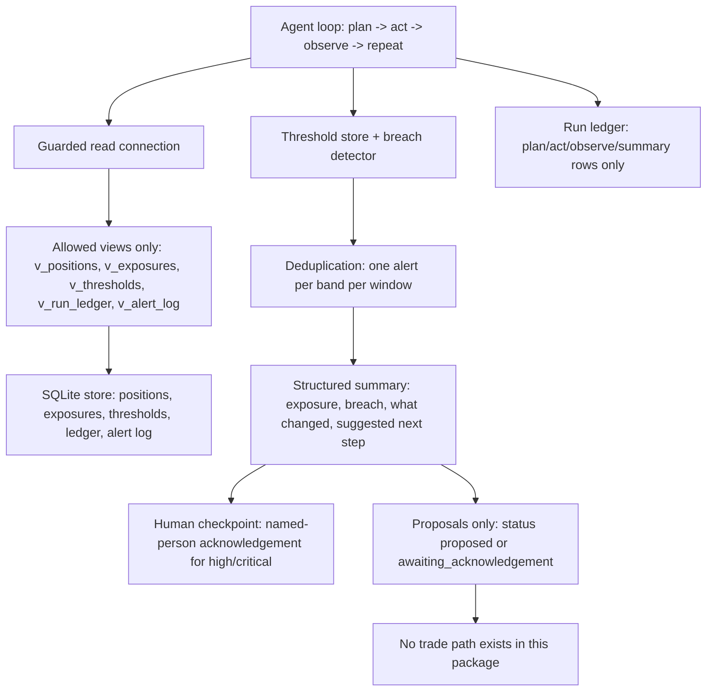

# Finance Portfolio Risk Agent

**Recruiter summary.** A single autonomous agent loop (plan → act →
observe → repeat) that watches a synthetic investment portfolio's risk
exposures, flags threshold breaches in severity tiers, suppresses repeat
alerts inside each breach window, and writes structured briefs a human
decision-maker can act on. It proposes changes and never executes a
trade. Proof: 59 tests pass on the standard library alone, including
named tests for every enforcement claim below — run them with
`python3 -m pytest tests -q`.

**All data is synthetic.** The firm in this repo, Kavellan Capital, is
invented for this project; instruments use invented codes, not real
tickers. Nothing here is real client, market, or portfolio data, and
nothing here claims any affiliation with any university, training
provider, or real financial firm.

> Note on the fictional name: the first name considered for the firm
> collided with a real dissolved company found by web search, so it was
> dropped and Kavellan Capital was invented instead. The invented name
> is used consistently across code, tests, and docs.

## Purpose and who it is for

Risk teams need a watcher that never sleeps but never acts alone. This
repo is a reference implementation of that watcher for:

- risk and portfolio analysts who want to see an agent loop with tools,
  memory, and checkpoints, not just a chatbot;
- engineers evaluating how to keep an autonomous agent inside strict
  guardrails (view-only data access, human approval, no trade path);
- interviewers and reviewers who want every enforcement claim backed by
  a named test they can run.

## Architecture



See `docs/architecture.md` and `knowledge/architecture.md` for the
full diagram and rationale.

## How it works, step by step

1. **Plan** — the agent reads exposures and thresholds through the
   authorizer-guarded connection, which only permits reads of allowed
   views (see `docs/guardrails.md`).
2. **Act** — it compares each exposure against its warn/high/critical
   thresholds, then checks the alert log: a breach band already alerted
   inside its window produces no repeat alert.
3. **Observe** — it appends plan/act/observe/summary rows to the run
   ledger, builds the structured summary, and marks high/critical
   breaches as awaiting a named-person acknowledgement.
4. **Repeat** — the next cycle re-reads state, so a changed exposure
   shows up under "what changed" and an expired window re-alerts.

Full walkthrough: `docs/how-it-works.md`. Real code and real output:
`docs/code-excerpts.md`.

## How to run (offline first)

```bash
python3 -m pytest tests -q            # 59 tests, standard library only
PYTHONPATH=src python3 -m portfolio_risk_agent.cli --cycles 2
```

No network, no API keys, no install step. Optional cloud use is not
part of this repo; see `docs/built-vs-planned.md`.

## Guardrails and security controls

- **View-aware SQLite authorizer** (default deny): base-table reads are
  allowed only when the authorizer's source argument names an allowed
  view; direct base-table reads, `sqlite_master`, writes, PRAGMA,
  ATTACH, and `load_extension` are denied. Authorizer tests run with the
  SQL-text pre-check disabled, so they prove the authorizer itself
  enforces the policy.
- **Confirmation gates**: approvals are named-person, single-use,
  scoped, and expiring; the gate additionally requires an explicit,
  confident "yes". Low-confidence replies and self-contradicting replies
  ("yes, wait, no") are rejected, as are bypass (unknown/expired/
  wrong-scope/reused token), reject ("no"), and absent (no token or no
  reply) paths.
- **Agent never executes trades**: no execution method exists in the
  package; proposals carry status `proposed` or
  `awaiting_acknowledgement`, and every summary states
  `trade_executed: false`.
- **PII redaction** covers card numbers, email addresses, phone numbers,
  and SSNs, applied to summaries and outbound messages.
- **Row cap at fetch time**: `fetchmany(MAX_ROWS + 1)` with
  `MAX_ROWS = 100`; no query text is rewritten and no full result set
  is ever pulled.
- **Cost/budget inputs reject negatives** (and NaN, infinities,
  booleans, non-numbers) instead of clamping them.
- **Brand guard**: blocked names are stored as SHA-256 hashes only, and
  `scripts/brand_check.py` scans docs and code by hash.
- **Email is dry-run by default**, needs explicit opt-in to queue, is
  refused in CI, and the channel takes no credentials of any kind.

Named proof tests for each claim are listed in
`docs/guardrails.md` and in the table below.

## Enforcement claims and their named proof tests

| Claim | Proof test(s) |
|---|---|
| Authorizer denies base-table / sqlite_master / writes / PRAGMA / ATTACH / load_extension | `test_authorizer.py::test_direct_base_table_read_denied_by_authorizer`, `test_sqlite_master_read_denied_by_authorizer`, `test_write_denied_by_authorizer`, `test_pragma_denied_by_authorizer`, `test_attach_denied_by_authorizer`, `test_load_extension_function_denied_by_authorizer` (all with text check disabled) |
| Gate bypass / reject / absent / low-confidence / contradicting-consent | `test_gates.py::test_gate_bypass_absent_token_rejected`, `test_gate_bypass_unknown_token_rejected`, `test_gate_bypass_wrong_scope_rejected`, `test_gate_bypass_expired_token_rejected`, `test_gate_bypass_reused_token_rejected`, `test_gate_reject_explicit_no`, `test_gate_reject_absent_reply`, `test_gate_reject_low_confidence_reply`, `test_gate_reject_self_contradicting_consent` |
| PII redaction incl. cards and emails | `test_redaction.py::test_redacts_card_number_with_spaces`, `test_redacts_card_number_with_dashes`, `test_redacts_email_address`, `test_redacts_phone_number`, `test_redacts_ssn` |
| Row cap via fetchmany(MAX+1) | `test_rowcap_costs_brand.py::test_row_cap_returns_max_plus_truncation_flag`, `test_no_fetchall_and_no_limit_rewriting_in_readers` |
| Negative-cost rejection | `test_rowcap_costs_brand.py::test_negative_cost_rejected`, `test_negative_budget_rejected`, `test_negative_cost_add_rejected_and_spend_unchanged` |
| Non-empty brand blocklist (hashes only) | `test_rowcap_costs_brand.py::test_brand_blocklist_is_non_empty`, `test_brand_blocklist_contains_no_plain_names`, `test_brand_check_flags_blocked_and_passes_innocent` |
| Breach deduplication | `test_breach_agent.py::test_breach_dedup_no_repeat_alert_same_window`, `test_breach_repeats_after_window_expires` |
| Agent never executes trades | `test_breach_agent.py::test_agent_never_executes_trades`, `test_summary_shape_and_no_trade`, `test_agent_cycle_finds_seeded_breaches` |

## Limitations and known failures (kept visible)

- Synthetic, single-portfolio demo: 4 exposures, 1 portfolio
  (`KAV-GROWTH`), no live market feed. See `docs/limitations.md`.
- Deduplication windows are only as durable as the alert log; if the
  database file is deleted, windows reset and breaches re-alert.
- The brand hash list catches exact blocked names only, not
  paraphrases or names absent from the list.
- Email has no real transport: the opt-in path only records to an
  outbox list for a future transport.
- No web UI, no scheduling daemon, no multi-portfolio support — all
  listed as Planned, not claimed as Built.

## Built / Written-not-run / Planned

| Item | Status |
|---|---|
| Agent loop with tools, threshold store, run ledger | Built, tested |
| Severity tiers + windowed deduplication | Built, tested |
| Structured summaries (exposure / breach / what changed / suggested next step) | Built, tested |
| Human checkpoints: proposals only, named-person acknowledgement for high/critical | Built, tested |
| View-aware authorizer, confirmation gates, PII redaction, row cap, cost validation, dry-run email | Built, tested |
| Autonomy trade-off documentation | Built (`docs/autonomy-tradeoffs.md`) |
| Live market data feed | Planned |
| Multi-portfolio support, persistent approval store, scheduler daemon | Planned |
| Deployment, packaging, hosted demo | Planned (not claimed) |

## Docs map (13-item checklist)

1. Recruiter summary — this README, top.
2. Purpose — this README; `docs/purpose.md`.
3. Architecture — `docs/architecture.md`, `knowledge/architecture.md`.
4. How it works — `docs/how-it-works.md`.
5. Real code excerpts + real output — `docs/code-excerpts.md`.
6. How to run — `docs/how-to-run.md` (offline first).
7. Guardrails — `docs/guardrails.md`.
8. Limitations — `docs/limitations.md`.
9. Built vs planned — `docs/built-vs-planned.md`.
10. Implementation guide — `docs/implementation-guide.md`.
11. Interview points — `docs/interview-points.md`.
12. Threat model + ADRs — `docs/threat-model.md`, `docs/adrs.md`.
13. Related repos — `docs/related-repos.md` (cross-links, no duplication).

Plus `knowledge/` notes distilled from the source pattern in the
author's own words (no source text reproduced, 8-word overlap check:
0 hits — see `scripts/overlap_check.py`).

## License and security

MIT — see `LICENSE`. Security policy and reporting — see `SECURITY.md`.
