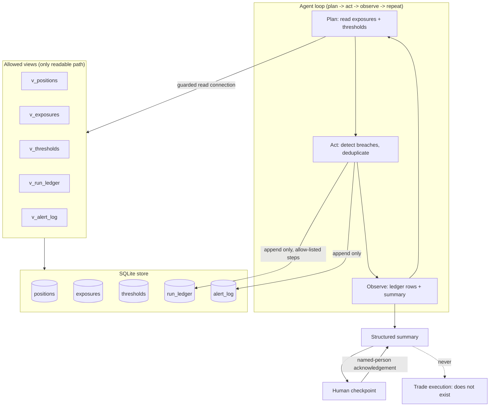

# Architecture

## Component map

| Component | File | Job |
|---|---|---|
| Guarded access + row cap + ledger appends | `src/portfolio_risk_agent/db.py` | Authorizer, views, `fetchmany` cap, the only write path |
| Synthetic seed | `src/portfolio_risk_agent/seed.py` | Invented positions, exposures, thresholds |
| Readers | `src/portfolio_risk_agent/readers.py` | View-only queries, no rewritten query text |
| Thresholds + dedup | `src/portfolio_risk_agent/thresholds.py` | Severity tiers, breach detection, window logic |
| Approvals + gates | `src/portfolio_risk_agent/approvals.py` | Named-person, single-use, scoped, expiring approvals; consent parsing |
| Redaction | `src/portfolio_risk_agent/redaction.py` | Card, email, phone, SSN masking |
| Summaries | `src/portfolio_risk_agent/summaries.py` | Four-section briefs, `trade_executed: false` |
| Costs | `src/portfolio_risk_agent/costs.py` | Negative-rejecting budget arithmetic |
| Notify | `src/portfolio_risk_agent/notify.py` | Dry-run-by-default email channel |
| Brand guard | `src/portfolio_risk_agent/brand.py` | Hash-only blocklist |
| Agent | `src/portfolio_risk_agent/agent.py` | The plan/act/observe/repeat loop |
