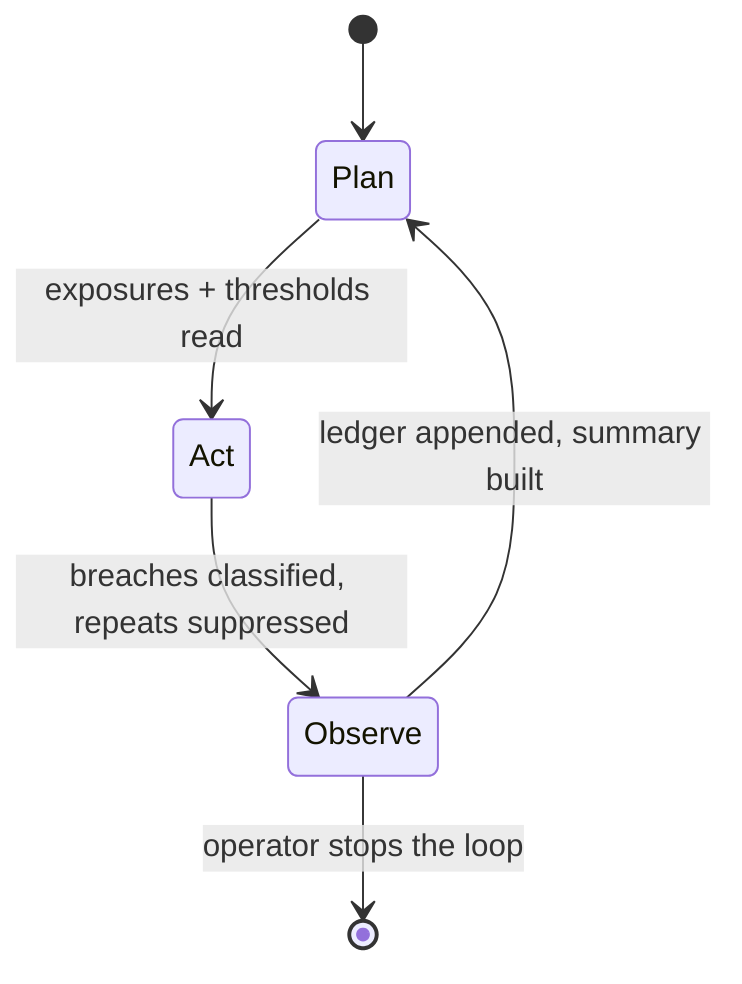
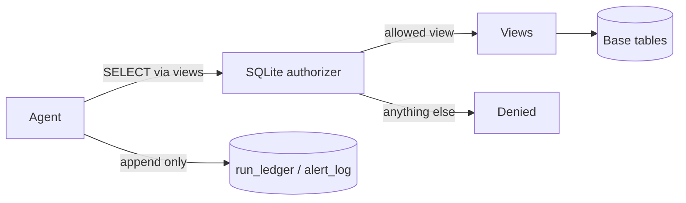

# Architecture notes (Mermaid)

## Agent loop



## Data flow through the guard



## Checkpoint flow for a high breach

```mermaid
sequenceDiagram
    participant A as Agent
    participant G as Confirmation gate
    participant H as Named human
    A->>A: Detect high breach
    A->>A: Proposal status = awaiting_acknowledgement
    H->>G: Acknowledgement with full name
    G->>A: Acknowledged; proposal may be shown as ready
    Note over A: The agent still does not act;<br/>a human decides elsewhere.
```
